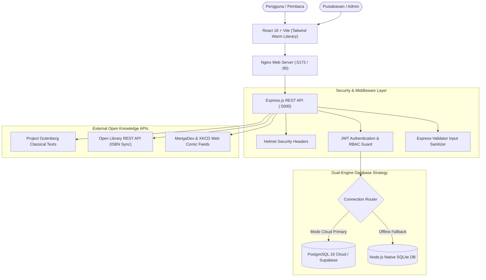

<div align="center">
  
  <h1>AksaraLoka</h1>
  <p><strong>Hybrid Library Platform & Open Knowledge Archive</strong></p>
  <p>Platform perpustakaan hibrida dengan sirkulasi fisik di rak, pembaca naskah digital langsung di peramban, serta arsitektur dual-engine database (SQLite Lokal & PostgreSQL Cloud).</p>

  [](https://github.com/luminariadev/aksaraloka/actions/workflows/ci.yml)
  [](LICENSE)
  [](https://react.dev/)
  [](https://nodejs.org/)
  [](https://expressjs.com/)
  [](https://www.postgresql.org/)
  [](https://www.docker.com/)
</div>

---

## 🏛️ Arsitektur Sistem



---

## 📖 Ringkasan Fitur Utama

### 1. Ruang Aksara Pembaca (User / Member)
- **Katalog Koleksi Hibrida**: Menjelajahi buku fisik di rak dan koleksi naskah digital secara seamless.
- **Naskah Klasik Terbuka (Project Gutenberg)**: Membaca karya klasik dunia (*The Art of War*, *Relativity*, *Meditations*, dll.) bab demi bab langsung di web dengan pilihan tema (Terang, Sepia, Gelap) dan ukuran teks.
- **Komik & Manga Daring**: Membaca komik visual (*XKCD Sains*, MangaDex publik) dengan pembaca panel vertikal *webtoon* atau *single page*.
- **Peminjaman & Sirkulasi**: Pengajuan pinjam buku fisik dengan penghitungan tanggal jatuh tempo dan kalkulasi denda keterlambatan harian secara otomatis.
- **Kartu Anggota Digital**: Identitas keanggotaan virtual ber-QR code dan nomor anggota unik.

### 2. Meja Kerja Pustakawan (Librarian Desk)
- **Meja Layanan Sirkulasi**: Pemrosesan peminjaman fisik, verifikasi pengembalian, dan restock buku otomatis.
- **Audit Kondisi Fisik & Stock Opname**: Pencatatan kondisi fisik eksemplar nyata (*Baik*, *Rusak Ringan*, *Rusak Sedang*, *Rusak Berat*, *Hilang*), catatan inspeksi pustakawan, dan stempel waktu audit.
- **Impor 1-Klik Koleksi Global**: Sinkronisasi jutaan data buku dari **Open Library REST API** berdasarkan judul, subjek, atau ISBN langsung ke database lokal/cloud.

### 3. Portal Administrator Sistem (Admin Desk)
- **Manajemen Pengguna & Peran**: Pengaturan hak akses peran (*ADMIN*, *LIBRARIAN*, *MEMBER*) dengan proteksi *anti-self lockout*.
- **Konfigurasi Kebijakan**: Pengaturan besaran denda harian, batas kuota pinjam, durasi peminjaman, dan nama resmi instansi.
- **Monitoring Dual-Engine**: Pemantauan status engine database yang sedang aktif (Cloud vs Local).

---

## 🗄️ Arsitektur Dual-Engine Database

AksaraLoka dirancang dengan konsep **Zero-Friction Offline & Cloud Synchronization**:

| Mode | Engine | Lokasi Data | Kegunaan |
| :--- | :--- | :--- | :--- |
| **Offline Lokal** | `node:sqlite` (Native) | `server/data/mylibrary_local.db` | Mode bawaan, zero-config, tahan saat internet terputus. |
| **Online Cloud** | **PostgreSQL** | Cloud Server / Supabase | Produksi, multi-user concurrent, pencadangan otomatis. |

> **Fail-Safe Mechanism:** Jika koneksi internet atau database cloud mengalami gangguan, backend otomatis beralih sementara (*auto-fallback*) ke SQLite lokal agar layanan perpustakaan tidak terhenti.

---

## 📁 Struktur Direktori

```text
aksaraloka/
├── .github/
│   └── workflows/
│       └── ci.yml               # Automated CI workflow
├── client/                      # Frontend: React 18, Vite, Tailwind CSS
│   ├── src/                     # Komponen UI, pembaca e-book, reader view
│   ├── public/                  # Aset statis & logo emblem vektor
│   ├── Dockerfile               # Multi-stage production Dockerfile (Vite + Nginx)
│   └── nginx.conf               # Konfigurasi reverse proxy Nginx
├── database/                    # Skrip skema database PostgreSQL & seeder
├── server/                      # Backend: Express.js, JWT, Dual-Engine DB
│   ├── src/                     # Controller, middleware, route, DB adapter
│   └── Dockerfile               # Node.js 20 production container
├── .dockerignore                # Rule exclude Docker
├── .gitignore                   # Rule exclude Git
├── docker-compose.yml           # Orkestras PostgreSQL 16, API server, dan client UI
├── LICENSE                      # Lisensi MIT
└── README.md                    # Dokumentasi utama proyek
```

---

## 🚀 Panduan Menjalankan

### Opsi 1: Menggunakan Docker Compose (Direkomendasikan)

Prasyarat: Terinstal Docker dan Docker Compose.

```bash
# 1. Clone repository
git clone https://github.com/luminariadev/aksaraloka.git
cd aksaraloka

# 2. Salin template konfigurasi
cp .env.example .env

# 3. Jalankan seluruh layanan
docker compose up -d --build

# Layanan aktif:
# - Frontend Web: http://localhost:5173
# - Backend REST API: http://localhost:5000
# - Database PostgreSQL: localhost:5432
```

---

### Opsi 2: Menjalankan di Lingkungan Lokal (Node.js)

#### 1. Persiapan Server
```bash
cd server
npm install
node src/index.js
# Server aktif di http://localhost:5000
```

#### 2. Persiapan Client
```bash
cd ../client
npm install
npm run dev
# Web app aktif di http://localhost:5173
```

---

## 🔑 Kredensial Pengujian Bawaan

| Role | Email | Password | Akses Portal |
| :--- | :--- | :--- | :--- |
| **Admin** | `admin@aksaraloka.id` | `Admin123!` | Meja Admin |
| **Pustakawan** | `librarian@aksaraloka.id` | `Librarian123!` | Meja Kerja Sirkulasi |
| **Anggota** | `member@aksaraloka.id` | `Member123!` | Katalog & E-Reader |

---

## 🧪 Pipeline CI/CD

Repository ini dipantau secara otomatis oleh **GitHub Actions** (`.github/workflows/ci.yml`):
- Pengecekan build frontend Vite bundle.
- Validasi dependensi & sintaks Express.js backend.
- Validasi struktur file `docker-compose.yml`.

---

## 📄 Lisensi

Didistribusikan di bawah lisensi **MIT**. Silakan tinjau berkas [`LICENSE`](LICENSE) untuk informasi lebih lanjut.

---

## 👤 Pembuat

**luminariadev**  
- GitHub: [@luminariadev](https://github.com/luminariadev)  
- Email: rizkianuari83@gmail.com

<!-- Daily commit: Thu, Nov 05, 2026 00:50:00 AM -->

<!-- Sync streak 2026-11-05: 00:54 WIB -->
